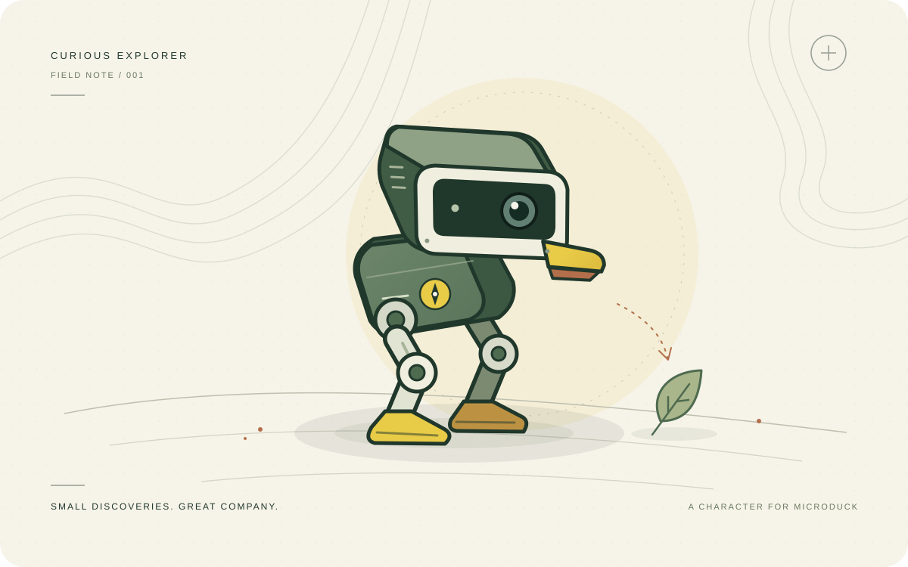

# Curious Explorer

**Small discoveries. Great company.**

A thoughtful character for Microduck, with a soft spot for small discoveries. Explorer is being built to notice a change, take a closer look, and leave room for the owner to take the lead.

## A character that fits right in

Curious Explorer is an additive persona project. Its behavior layer requests supported actions from the duck’s existing software. It does not replace firmware, install a walking model, change controller mappings, or overwrite an owner’s skills. Optional gestures require explicit permission.

One character, with a consistent temperament: observant, patient, and quietly playful.

## Installation status

**An installable persona is not available yet.** This repository contains development source, tests, and documentation. Downloading it does not install a character on a duck.

The browser demonstration has been separated into a local development tool. It is not included in the current repository or intended persona downloads. The previous Hugging Face demonstration has been retired; Hugging Face is not currently an installation destination for this project.

Before publishing an owner-ready package, we need to validate Microduck’s supported add-on installation mechanism, confirm compatibility in the official simulator, and test installation, updates, removal, and control handoff on hardware.

[What to expect from installation →](docs/getting-started.md)

## What is here today

- **Behavior core:** dependency-free JavaScript that turns supplied observations into character intentions. It starts with an empty skill inventory.
- **Experimental connector:** a local development API targeting Microduck API 44. It has protocol-fixture tests; official simulator and hardware validation are still outstanding.
- **Tests and design documentation:** permission boundaries, pause behavior, memory handling, and the character’s voice and visual style.

There is no browser app, hosted-demo builder, sensor perception, conversational AI, background startup service, or physical-robot installer in this development tree. The behavior core and connector are components for further integration, not a complete autonomous runtime.

## Your duck stays yours

Existing skills remain the owner’s. The connector has no skill-install, replacement, deletion, policy-write, or controller-configuration operation. It only requests allowed actions. A compatible gesture must be reported by the endpoint and permitted before Explorer may use it.

Preserving installed files and sharing control are separate responsibilities. The current experimental connector requires an explicit, exclusive session. A running discrete skill may finish after a pause. Automatic takeover detection and physical stopping behavior have not been validated.

[Compatibility and boundaries →](docs/compatibility.md)

## From the workshop

Developers can run the behavior checks with `npm test` and the connector checks with `python3 -m unittest discover -s tests -p 'test_*.py'`. The connector requires Python 3.11 or later and has no third-party Python dependencies.

- [Architecture and developer setup](docs/architecture.md)
- [Character and voice](docs/character-and-voice.md)
- [Development notes](CHANGELOG.md)
- [Official Microduck project](https://github.com/pollen-robotics/microduck)

---

An independent community project by **hidrogencloride**. Not affiliated with Pollen Robotics, Hugging Face, or NVIDIA. The original artwork represents the character, not an engineering diagram of Microduck.

Code, documentation, and original artwork are available under the [Apache 2.0 license](LICENSE).
